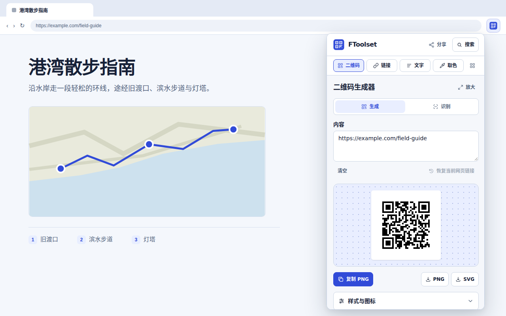

# FToolset

FToolset 是一个离线运行的 Chrome 多工具扩展，聚焦**网页链接、文字与屏幕配色的本机快捷处理**。内置二维码生成与识别、链接净化、文字整理与字数统计、网页取色与对比度检查四款高频工具，支持 Chrome 111 及以上版本，界面提供简体中文和英文，并随系统自动适配浅色 / 深色模式。



## 内置工具

- **二维码生成器（生成 + 离线识别）**
  - 打开扩展自动填入当前网页链接（当 Chrome 授权读取时），也支持手动输入或右键链接/所选文字直达。
  - 自定义方形/圆点/圆角/复古码点、前景色、背景色、四档纠错等级与本机 PNG/JPG/SVG 中心图标，支持复制 PNG 或下载 `512 × 512` PNG / 可缩放 SVG。
  - 切换到「识别」模式，支持 `Ctrl+V` 粘贴截图、拖拽或选择本机图片离线解析二维码，识别到 `http://` / `https://` 链接时需用户主动点击才打开。
- **链接净化**
  - 自动剥离当前网页或粘贴链接中的常见追踪参数（如 `utm_*`、`fbclid`、`gclid`、`spm`、`si` 等），并保留核心功能参数。
  - 可视化列出已移除参数，支持点击单个参数一键还原，或将净化后的短链接直接转交二维码生成器。
- **文字整理与字数统计**
  - 实时统计总字符数、不含空格字符数、词数、汉字数、段落数与预计阅读时长（原生 `Intl.Segmenter`）。
  - 一键清理多余空格、去空行、修复 PDF 复制断行、行去重及英文大小写转换，支持 10 步撤销与还原原文；网页划选文字可通过右键菜单直达。
- **网页取色**
  - 调用浏览器原生 `EyeDropper API` 吸取屏幕任意像素颜色（零额外权限），自动复制 HEX 并支持一键复制 HEX / RGB / HSL。
  - 内置黑白文字 **WCAG 2.1** 可读性对比度评估（`AAA / AA / AA 大字 / 偏低`），并在本机保存最近取色（最多 12 条）与收藏色板（最多 24 条）。

## 快捷导航与大屏工作台

- **顶栏原地搜索**：点击右上角「搜索」（或按 `/`、`Ctrl/Cmd+K`），第一行原地切换为内联搜索框，输入中英文关键词回车直达，顶栏零高度抖动。
- **可自定义 4 槽快捷栏与「全部工具」页**：默认固定 4 个常用工具单行直达；点击右侧「全部」可进入独立目录页，自由调整固定项、排序或显隐快捷栏。
- **新标签页放大模式**：点击工具标题旁的「放大」可在独立扩展标签页（`popup.html?view=tab`）以宽屏两列布局继续处理长文本、链接或配色，并自动带入当前草稿。

从 Chrome 网上应用店安装后，弹窗顶栏的「评分」会打开评论页，「分享」会复制商店安装链接。从源码加载时，「分享」会复制 GitHub 项目链接。自动复制失败时，弹窗会显示可手动复制的链接。

## 从源码安装

需要 Node.js 22.12 及以上的 22.x 版本、24.x，或 26 及以上版本。

```bash
git clone https://github.com/fenghuashao/FToolset.git
cd FToolset
npm ci
npm run build
```

1. 在 Chrome 中打开 `chrome://extensions`，开启「开发者模式」。
2. 点击「加载已解压的扩展程序」，选择项目里的 `.output/chrome-mv3` 目录。[Chrome 官方安装说明](https://developer.chrome.com/docs/extensions/get-started/tutorial/hello-world#load-unpacked)
3. 从 Chrome 工具栏的扩展菜单打开 FToolset，也可以将它固定到工具栏。

## 开发与测试

项目使用 WXT、React、TypeScript 和 Tailwind CSS，构建为 Manifest V3 扩展。运行 `npm run dev` 进入开发模式。

```bash
npm run typecheck
npm test
npx playwright install chromium
npm run build
npm run test:e2e
```

Playwright 端到端测试会在 Chromium 中加载 `.output/chrome-mv3` 中的构建产物。运行 `npm run zip` 可生成 `.output/ftoolset-<版本>-chrome.zip`，提审步骤见 [Chrome Web Store 提审清单](store-assets/RELEASE_CHECKLIST.md)。

- `entrypoints/` 包含工具栏弹窗/全屏工作台和后台 Service Worker。
- `src/tools/` 包含工具注册表及 `qr-code`、`link-cleaner`、`text-cleaner`、`color-picker` 实现。
- `public/_locales/` 包含简体中文和英文文案。

## 隐私与权限

所有二维码编解码、链接净化、文字处理与屏幕取色均在浏览器本机离线完成，生产 CSP 严格禁止任何外连（`connect-src 'none'`）。扩展仅申请 `activeTab`、`storage`、`contextMenus` 三项最小权限，不使用 Chrome 同步存储，无需账号，也不收集任何使用统计。[隐私政策](store-assets/PRIVACY.md) · [Chrome 权限说明](store-assets/PERMISSIONS_JUSTIFICATION.md) · [第三方许可通知](public/THIRD-PARTY-NOTICES.txt)

## 开源许可

本项目采用 MIT 许可证，详见 [LICENSE](LICENSE)。
