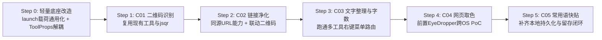

# FToolset 工具候选清单与下一阶段选型建议（FTOOLSET-TOOL-CANDIDATES）

> **文档状态**：选型建议已确认（2026-11-24 已记录产品决策，待启动下一阶段设计与开发）  
> **编制日期**：2026-11-24  
> **前置分析文档**：[`UTOOLS-RESEARCH-SYNTHESIS.md`](./UTOOLS-RESEARCH-SYNTHESIS.md)  
> **产品基线**：FToolset `v1.1.0`（Chrome 111+，仅 `activeTab` / `storage` / `contextMenus`，生产 CSP `connect-src 'none'`，纯本机离线、不使用 `storage.sync`、中英双语）

---

## 0. 筛选原则与分级口径

结合 FToolset 当前架构与大众定位，本清单围绕七个维度综合筛选（不搞伪精确打分）：
1. **大众需求与频度**：普通办公族、学生、内容创作者能否零门槛理解并反复使用，且中英双语全球用户均有价值。
2. **Chrome 扩展形态增益**：是否充分利用当前标签页 URL、选中文本、屏幕像素或浏览器内零切换优势。
3. **纯前端本地可行性**：是否满足 100% 离线、`connect-src 'none'`、无远程 Worker/脚本、轻量可控包体。
4. **操作体验与容器适配**：首批优先在现有 `400px` Popup 中完成短平快闭环；宽画布/长任务延后至独立工具页或 Side Panel。
5. **开发与长期维护成本**：尽量少依赖、少外部规则维护、边界情况可控。
6. **权限、隐私与 CWS 合规**：首批坚守**零新增权限**、不使用 `storage.sync`，并满足 Chrome Web Store **Single Purpose（单一用途）** 主题聚焦要求。
7. **与现有能力协同**：优先复用现有 `activeTab`、`contextMenus`、`storage.session`、图片解码与二维码生成能力。

**四级分类定义**：
- **优先开发（5 项）**：需求明确、与现有定位高度内聚、零新增权限、投入产出比最高，建议作为下一阶段核心范围。
- **后续开发（8 项）**：大众价值明确，但因单用途叙事外延、容器宽度需求或产品形态待定，适合在首批稳定后再推进。
- **储备观察（7 项）**：存在潜在价值，但需新增权限、包体偏重、与系统能力重叠或与无同步策略存在张力，暂缓立项。
- **不建议引入（3 项具体候选 + 8 类排除工具族）**：与双语大众定位、纯本地 CSP 或浏览器沙盒边界冲突。

---

## 一、去重后的统一工具候选清单（23 项）

> 来源标记：`A#xx` = [报告 A（ChatGPT）](./sources/FToolset-uTools-Research-2026-11-23.md) 编号；`B-Px` = [报告 B（Gemini）](./sources/ftoolset_utools_plugin_research_report.md) 梯队。  
> 权限标记：`现有` = 仅用 `activeTab` / `storage` / `contextMenus`（或 0 权限）；`+S` = `scripting`；`+SP` = `sidePanel`（Chrome 114+/116+）；`+AL/+N` = `alarms`/`notifications`。

| 编号 | 统一工具名称 | 来源追溯（含去重合并） | 核心用户场景 | 权限与容器 | 推荐分类 | 一句话筛选依据（【分析判断】） |
|---|---|---|---|---|---|---|
| **C01** | **二维码工具增强（生成 + 本地识别）** | A#03(P0/Top6) + B-P1（二维码解析） | 粘贴截图或选本地图识别二维码，与现有生成功能闭环 | 现有；Popup | **优先开发** | 零新入口、复用现有 `qr-code` 与 `jsqr`（已在 `devDependencies`），天然闭环。 |
| **C02** | **链接净化与追踪参数清理** | B-P0（独有） | 去除当前页或复制链接中的 `utm_*`/`fbclid`/`spm` 等追踪参数 | 现有；Popup | **优先开发** | 零依赖、零新权限，直接复用 `currentPageUrl`，还可一键联动生成更简短二维码。 |
| **C03** | **文字整理与字数统计** | A#01(P0/Top6) + B-P0(Top6) + B-P1（英文大小写部分） | 统计中英字数/阅读时长、修 PDF 断行、去空行/空格/重行、英文大小写 | 现有；Popup | **优先开发** | 双源 Top 6 共识，大众最高频文本痛点，右键选文直达，原生 `Intl.Segmenter` 零依赖。 |
| **C04** | **网页取色与配色助手** | A#02(P0/Top6) + A#18（图片找配色，后期）+ B-P0(Top6) | 屏幕吸色、复制 HEX/RGB/HSL、检查文字对比度、收藏色板 | 现有；Popup（+后备页） | **优先开发** | 双源 Top 6 共识，原生 `EyeDropper` 零新增权限；开发前需先实测跨系统 Popup 生命周期。 |
| **C05** | **常用短语 / 常用语快贴** | A#06(P1/Top6) + B-P1 | 收藏常用回复、地址、邮箱、模板，搜索后一键复制 | 现有；Popup | **优先开发** | uTools 217 万用户强信号，零敏感权限替代“剪贴板历史”，是提升长期留存的锚点。 |
| **C06** | **日常计算与计算稿纸** | A#04(P0/Top6) + B-P1(Top6) | 边写说明边算账（汇总/折扣/比例），适合比价与预算 | 现有；Popup/侧栏 | **后续开发** | 强需求（uTools 280 万用户），但需先拍板“固定表单 vs 自由稿纸”并避开 712 KB `mathjs`。 |
| **C07** | **常用单位换算** | A#05(P0/Top6) + B-P0 | 长度/重量/温度/容量/存储大小换算，海淘与阅读英文资料 | 现有；Popup | **后续开发** | 纯前端低成本、零新权限，但偏场景触发且与首批“网页内容整理”主线关联略弱。 |
| **C08** | **两段文字对比（找不同）** | A#07(P1) + B-P1 | 对比两版文案/邮件/合同条款的增删改差异 | 现有；独立页/侧栏 | **后续开发** | 办公刚需且与 C03 同域，但 400px Popup 并排阅读局促，宜待独立工具页就绪后接入。 |
| **C09** | **强密码生成器（无状态）** | A#08(P1) + B-P0(Top6) | 注册账号时本地生成高强度随机/词组密码，不持久化密码 | 现有；Popup | **后续开发** | 零新权限且开发快，但 Chrome 已内置密码生成，且与首批主线关联度弱于 C01–C05。 |
| **C10** | **日期与天数 / 倒数日计算** | A#10(P1) + B-P0 | 算日期间隔天数、N 天后日期、关键截止日提醒 | 现有；Popup | **后续开发** | 轻量零新权限，适合与 C06/C07/C11 作为第二批「效率小算盘」组合评估。 |
| **C11** | **世界时钟与时区换算** | A#09(P1) + B-P0(Top6) | 跨时区会议时间轴对照、夏令时感知、复制多时区邀约 | 现有；Popup/侧栏 | **后续开发** | 跨国办公高价值，用 `Intl` + `@date-fns/tz` 极轻，但非全员刚需，宜放第二批。 |
| **C12** | **网页可见区截图与轻标注** | A#12(P1) + A#17(P2) + B-P1 | 截取当前可见网页，快速裁剪、画框/箭头、敏感信息打码 | 现有（`activeTab`）；独立页 | **后续开发** | 强浏览器原生场景，零新权限；因标注需宽画布，宜作为引入独立扩展页后的首发工具。 |
| **C13** | **本地图片轻量处理工作台** | A#14(P2) + A#15(P2) + B-P2 | 压缩、JPG/PNG/WebP 转格式、调整尺寸与裁剪（单入口整合） | 现有；独立页 | **后续开发** | 办公上传图片刚需；需避开 CDN Worker 陷阱并采用独立扩展页承载，工程量中等偏上。 |
| **C14** | **网页正文提取与剪藏** | A#13(P1) + B-P1(Top6) | 去除网页广告提取文章正文为纯文本/Markdown | `+S`；Popup/侧栏 | **储备观察** | 需新增 `scripting` 权限且 SPA/付费墙适配维护成本高，建议首批零新权限过审后再议。 |
| **C15** | **图片加水印与截图美化** | B-P2（独有） | 证件照防盗用水印、截图加渐变圆角阴影发社媒 | 现有；独立页 | **储备观察** | 有亮点且纯 Canvas 可做，但属于图片工作台延伸能力，应在 C12/C13 验证后再扩展。 |
| **C16** | **图片拼接（长图拼接）** | A#16(P2 独有) | 多张截图纵向/横向拼为一张说明图 | 现有；独立页 | **储备观察** | 频度低于压缩与标注，未来可作为图片工作台子模式而非独立主工具。 |
| **C17** | **本地 PDF 合并与拆页** | A#22(P2) + B-P2 | 离线合并 PDF、提取或旋转页码 | 现有；独立页 | **储备观察** | `pdf-lib` + 缩略图（`pdfjs-dist`）包体与内存开销大，加密 PDF 边界多，暂缓投入。 |
| **C18** | **轻量便签与每日待办** | A#19(P2) + A#20(P2) + B-P2 | 边看网页边记临时想法与今日待办 | `+SP`；侧栏 | **储备观察** | 强依赖 Side Panel（Chrome 114+/116+）且用户普遍期待多端同步，与现行无同步政策有张力。 |
| **C19** | **极简番茄钟 / 专注计时** | A#21(P2) + B-P2 | 25/5 分钟专注倒计时与到期轻提醒 | `+AL`（可选 `+N`）；Popup/侧栏 | **储备观察** | 需新增 `alarms`/通知权限，与内容处理主题距离最远，存在 CWS 单一用途分散风险。 |
| **C20** | **Emoji 与常用符号速查** | A#11(P1 独有) | 检索 ✓/→/© 与常用表情并复制 | 现有；Popup | **储备观察** | 成本极低，但 Windows（`Win+.`）与 macOS（`Ctrl+Cmd+Space`）系统自带面板已覆盖主力需求。 |
| **C21** | **中文简繁转换（OpenCC）** | B-P1（独有拆分） | 大陆简体与港澳台繁体及用词习惯离线互转 | 现有；Popup | **不建议引入** | 词典体积大（数百 KB 至 MB 级）且仅服务中文用户，违背轻量化与中英双语全球化原则。 |
| **C22** | **网页图片批量提取与打包** | B-P2（独有） | 嗅探页面全部大图/SVG 并打包 ZIP 下载 | `+S`；独立页/侧栏 | **不建议引入** | 受 CORS、防盗链及 FToolset `connect-src 'none'` CSP 严格阻断，且涉及抓图版权审核风险。 |
| **C23** | **本地 OCR 文字识别** | A（独立实验边界）+ B（红线排除） | 离线识别图片中的中英文文字 | 现有（需放宽 WASM CSP） | **不建议引入** | WASM + 中英模型达数十 MB、需放宽 CSP 且体验不及 Chrome 内置 Google Lens 识图。 |

### 明确排除的 uTools 热门工具族对照（共 8 类，双源高度一致）

| 排除类别 | 代表 uTools 插件 | 淘汰核心原因（结合 FToolset 定位） |
|---|---|---|
| 1. 全局剪贴板历史 | 剪贴板 / 超级剪贴板 | MV3 Service Worker 休眠无法无感监听系统复制；轮询剪贴板触碰隐私与 CWS 拒审红线（由 **C05 常用语** 合规替代）。 |
| 2. 本地磁盘搜索 | 本地搜索（Everything） | 突破浏览器安全沙盒，无法索引操作系统本地文件。 |
| 3. 跨应用截图与桌面贴图 | 悬浮 / 兔灵截图全功能 | 扩展无法截取桌面其他软件画面或创建系统级置顶悬浮窗（仅保留浏览器子集 **C12**）。 |
| 4. 磁盘批处理与系统自动化 | 批量重命名 / 快捷命令 RPA | 缺乏本机进程能力；File System Access 频繁弹窗且易引发大众安全恐慌。 |
| 5. 程序员编码与调试集 | Ctool / 编码小助手 / 时间戳 | 面向开发者（JSON/正则/JWT/Cron/Base64/哈希/Unix 时间戳），抬高大众认知门槛。 |
| 6. 中国本土强绑定工具 | 电子发票 / 微信排版 / 国内网盘 | 违背中英双语全球化原则。 |
| 7. 账号密码保险库 | 密码管理器（托管功能） | 安全与数据丢失责任极重，且与 Chrome 内置密码管理重叠（仅保留无状态 **C09**）。 |
| 8. 联网云服务与浏览器重叠项 | 在线翻译 / 实时汇率 / AI / 网页快开 | 违背纯离线无后端原则；“网页快开”与 Chrome 地址栏和书签高度重叠。 |

---

## 二、四级分类策略说明

- **为什么首批聚焦 C01–C05（5 项）而非直接塞入计算/时钟/密码？**
  1. **CWS 单一用途叙事高度自洽**：C01（二维码生成与识别）、C02（链接净化）、C03（文字整理与字数）、C04（网页取色）、C05（常用语快贴）全部围绕同一条窄而清晰的主题——**「离线处理你在浏览器中遇到的链接、文字与网页配色，并快捷复制或分享」**。这能最大限度降低从单功能扩展升级为多工具扩展时的 CWS Single Purpose 审核风险。
  2. **100% 零新增权限、零架构重构成本**：5 项工具全部复用现有 `activeTab`、`storage`、`contextMenus`，完全不触发 Chrome 安装权限警告，无需改动 `minimum_chrome_version: 111`，也不必在首批就引入 `sidePanel` 或 `scripting`。
  3. **形成“高频入口 + 留存锚点”组合**：C01/C02 承接当前页链接分享（强浏览器原生），C03/C04 承接办公与创作即时处理（双源一致推荐），C05 提供反复打开的复访理由。
- **为什么 C06–C13 归入「后续开发」？**
  - **C06–C07、C09–C11**（计算稿纸、单位换算、密码、日期、世界时钟）：纯前端价值真实、无权限障碍，但偏“独立小工具”而非“当前网页内容加工”，待首批 5 项过审并验证多工具交互与用户留存后，可按用户反馈择优引入。
  - **C08、C12–C13**（文本对比、网页可见区截图与标注、图片轻量压缩裁剪）：普遍需要宽画布承载，适合作为第二阶段引入**独立扩展页（`tool.html`）**时的配套工具一次性解锁。

---

## 三、下一阶段首批推荐工具深度方案（5 项）

### 推荐 1：二维码工具增强（C01 · 现有工具升级）

- **推荐理由与用户价值**：
  - 完善 FToolset 现有唯一工具的“生成 ↔ 识别”完整闭环，不增加工具列表负担，老用户无感获得直接升级。
  - 办公或浏览网页收到二维码图片、电脑端不想掏手机扫码时，粘贴截图即可本机还原链接或文字。
- **最小可用功能范围（MVP）**：
  - 在现有 [`qr-code`](../../src/tools/qr-code/index.tsx) 顶部增加轻量子标签切换：**「生成」 / 「识别」**（默认仍停留在「生成」，保留打开即生成当前页二维码的 0 摩擦体验）。
  - 「识别」支持三种本机输入：**`Ctrl+V` 粘贴图片、拖拽图片、点击选择本地图片**（支持 PNG/JPG/WebP/GIF 首帧，沿用 `image.ts` 4 MB / 4096px 校验边界）。
  - 解码成功后展示纯文本结果、一键「复制结果」；仅当结果为合法 `http:` / `https:` URL 时额外提供用户主动点击的「打开链接」按钮，**严禁自动跳转及执行 `javascript:` / `data:` 等协议**。
  - 识别失败（非二维码、反色/模糊/多码）给出明确可理解提示，并允许一键尝试基础灰度/缩放重试。
- **交互形态与技术实现方向**：
  - **容器**：现有 `400px` Popup 内完成。
  - **技术方案**：将已在 `package.json` `devDependencies` 中的 `jsqr@1.4.0`（纯 JS、零依赖）移入 `dependencies` 作为全平台统一核心解码器；可按需做能力探测，在支持 `BarcodeDetector` 的 macOS/ChromeOS 上先试原生再无缝回退 `jsqr`（【已验证事实】：Windows/Linux 桌面版 Chrome 不支持 `BarcodeDetector`）。复用 [`src/tools/qr-code/image.ts`](../../src/tools/qr-code/image.ts) 的解码与 Canvas 绘制工具函数。
  - **明确不做**：首版不承诺右键网页图片直读（避免 CORS 与 `connect-src 'none'` 冲突）；“截取当前可见区扫码”留作后续增强。
- **开发复杂度与主要风险**：
  - **复杂度**：低—中（约 1–2 天）。
  - **主要风险**：① 需将 `jsqr` 的 Apache-2.0 许可声明补充至 [`public/THIRD-PARTY-NOTICES.txt`](../../public/THIRD-PARTY-NOTICES.txt)；② `input[type=file]` 在部分操作系统下弹出系统文件选择器可能导致 Chrome Popup 关闭（【待验证事项】：需在 Windows/macOS 实测，优先突出 `Ctrl+V` 粘贴与拖拽作为最稳路径；注：现有上传 Logo 已用 `input[type=file]`，可顺带复测其跨平台表现）。

---

### 推荐 2：链接净化与追踪参数清理（C02 · 新增工具）

- **推荐理由与用户价值**：
  - 电商、社交媒体、新闻与视频链接普遍夹带冗长追踪参数（`utm_*`、`fbclid`、`gclid`、`spm`、`igshid`、`si`、`ref_` 等），分享给同事或贴进文档既杂乱又暴露来源追踪。
  - 与现有二维码工具**同属“当前页链接分享”核心场景**，直接复用 `activeTab` 获取的 `currentPageUrl`，零新增权限、零第三方依赖，且支持**净化后一键转交二维码工具生成更简洁、更易扫的二维码**。
- **最小可用功能范围（MVP）**：
  - 打开工具自动填充当前标签页 URL（若为 `http:`/`https:`），也支持手动粘贴或右键链接进入。
  - 自动剥离内置开源规则集匹配的常见追踪参数，展示**净化后链接** + **已移除参数列表（标签形式）**，支持用户取消勾选某个参数以防误删。
  - 提供「复制干净链接」「用此链接生成二维码」「恢复原始链接」三个动作；若当前链接本就干净，明确提示“未发现常见追踪参数”。
- **交互形态与技术实现方向**：
  - **容器**：`400px` Popup。
  - **技术方案**：纯原生 `URL` / `URLSearchParams` + 精简内置 JSON 规则表（分为全局通用追踪参数与少量主流域名规则，如 Amazon/YouTube/Bilibili 仅剥离已知追踪键，**白名单保护** `v`、`q`、`id`、`p`、`page` 等功能参数），包体增量 < 5 KB。
- **开发复杂度与主要风险**：
  - **复杂度**：低（约 1–2 天）。
  - **主要风险**：① 误删业务必需参数导致链接失效——通过保守默认规则 + 可视化移除清单 + 单项还原开关兜底；② 非标准 URL（含中文、Hash 路由 `#/?utm=...`）需补足单元测试覆盖。

---

### 推荐 3：文字整理与字数统计（C03 · 新增工具）

- **推荐理由与用户价值**：
  - 两份调研报告均列为 Top 6 的最高共识项。办公人员、学生、内容创作者每天都会遇到：查中英文字数与阅读时间、从 PDF/网页复制出破碎换行、清理多余空行/空格/重复行、统一英文标题大小写。
  - 浏览器增益明显：任意网页划选段落 → 右键「整理文字」直接带入弹窗，省去新建文档或打开在线字数统计网站的步骤。
- **最小可用功能范围（MVP）**：
  - 多行纯文本输入框（不自动填入 `currentPageUrl`，避免干扰；右键选文触发时自动带入选中文本）。
  - 顶部紧凑统计条：**字符数（不含空白 / 含空白）、中文字数、英文词数、段落数、预计阅读时长**，并明确口径。
  - 一排清晰的一键整理动作：
    - `去除多余空行`、`清理重复空格与首尾空白`
    - `整理 PDF 断行`（显式可选，保留空行段落边界，不默认合并所有换行）
    - `行去重`
    - `英文大小写`（全部大写 / 全部小写 / 句首大写 / 标题大写）
  - 保留「撤销上一步（至少 5 步内存栈）」「重置原文」「一键复制」。
- **交互形态与技术实现方向**：
  - **容器**：`400px` Popup（短平快为主）。
  - **技术方案**：纯原生 TypeScript + 浏览器内置 `Intl.Segmenter`（Chrome 87+ 原生支持，精准区分用户感知字素、Emoji 组合序列及中英文分词，避免 `string.length` 的 UTF-16 误计数）。零第三方依赖；大文本（如 > 50,000 字符）对实时统计做 `150ms` 防抖，避免输入掉帧。
- **开发复杂度与主要风险**：
  - **复杂度**：低—中（约 2–3 天，含通用右键多工具路由改造）。
  - **主要风险**：① 英文 Title Case 与中英混排标点/断行存在边界情况（诗歌、代码、地址不宜强改）——坚持“用户主动点按钮 + 可一键撤销”；② 右键菜单文字长度较大时需控制 `storage.session` 写入上限并及时消费清理。

---

### 推荐 4：网页取色与配色助手（C04 · 新增工具）

- **推荐理由与用户价值**：
  - 双源 Top 6 共识，uTools「颜色助手」拥有 48 万页面用户与 4.6/114 评分。做 PPT、海报、文档、个人网站时，用户常需要快速吸取网页上的颜色并直接复制色值，同时判断白字/黑字是否清晰可读。
  - 借助原生 `EyeDropper API`，**零新增权限**即可做到比传统取色扩展更安全、更轻量的吸色体验。
- **最小可用功能范围（MVP）**：
  - 醒目的「从屏幕取色」主按钮（直接同步响应点击调用 `new EyeDropper().open()`，避免异步延迟丢失用户激活手势）。
  - 取色结果区：大色块预览 + 一键复制 **HEX、RGB、HSL**；支持手动输入/粘贴 HEX 色值反向预览。
  - 轻量实用加成：**黑白文字可读性提示**（纯原生计算 WCAG 2.1 对比度比值及 AA/AAA 标识，零依赖）。
  - 本地最近取色（最多 12 条）与少量收藏色块（保存在 `chrome.storage.local`，提供清空按钮）。
  - Esc 取消为正常行为，保留上一次颜色结果，不报错误提示。
- **交互形态与技术实现方向**：
  - **容器**：`400px` Popup 为主；若实测在特定 OS 下 Popup 失焦导致取色中断，提供一键打开扩展内独立极简取色页作为兜底（**绝不新增 `scripting` 权限**）。
  - **技术方案**：原生 `EyeDropper API`（Chrome 95+）+ 原生 HEX/RGB/HSL/WCAG 纯函数（无需引入 `culori`，或者按需评估仅 1.8 KB 的 `colord`）。明确说明采集的是屏幕渲染像素 `sRGBHex` 而非 DOM 原始 CSS 属性。
- **开发复杂度与主要风险**：
  - **复杂度**：低—中（约 2–3 天，含跨平台验证）。
  - **主要风险**：**【待验证事项·高优先级】** 在 Windows、macOS、Linux（X11/Wayland）真实 Chrome 环境下，Popup 内调用 `EyeDropper.open()` 点击外部像素时是否会因失焦关闭弹窗或丢失 Promise 返回值。**建议在正式排期前用 30 分钟最小 PoC 在真实机器实测**，根据实测结果决定是否需要附带极简扩展页后备路径。

---

### 推荐 5：常用短语 / 常用语快贴（C05 · 新增工具）

- **推荐理由与用户价值**：
  - uTools「备忘快贴」拥有 217 万页面用户、4.6/190 评分，是办公高频复用的刚需。
  - 合规承接“剪贴板复用”诉求：相比会被 CWS 拒审的后台剪贴板监听，常用语由用户主动收藏与管理，既解决重复输入邮箱、地址、发票抬头、客服/邮件模板的痛点，又能形成 FToolset 的**长期高频复访粘性**。
- **最小可用功能范围（MVP）**：
  - 每条常用语包含极简结构：**标题（可选）、正文内容、置顶星标、更新时间**。
  - 支持两种录入：Popup 内手动新增；或在网页划选文字 → 右键「存为常用语」→ 打开 Popup 预填内容并可补充标题后确认保存。
  - Popup 顶部实时关键词搜索（按置顶优先、最近更新排序），点击条目或「复制」按钮一键复制到剪贴板；支持编辑、删除（带明确确认或短暂撤销）。
  - 提供**本地 JSON 导出 / 导入备份**（导入前校验结构，避免损坏现有数据）。
  - 界面底部/首次新增时明确温和提示：**仅存储在当前浏览器本机，非加密保险库，请勿保存银行卡密码等高敏凭证**。
- **交互形态与技术实现方向**：
  - **容器**：`400px` Popup（首版聚焦轻量管理，不做网页输入框自动注入，避免 `scripting` 权限与复杂站点焦点兼容问题）。
  - **技术方案**：严格使用 `chrome.storage.local`（**严禁 `storage.sync`**，与 [`PRIVACY.md`](../../store-assets/PRIVACY.md) 保持一致），纯文本存储与 React 默认转义渲染。搜索复用原生子串分词匹配（零依赖）。对于存储写入，沿用/抽离简单串行写入队列，防止连续操作或未来多视图并发覆盖。
- **开发复杂度与主要风险**：
  - **复杂度**：中（约 3–4 天，因涉及完整 CRUD、导入校验与隐私政策更新）。
  - **主要风险**：① 引入用户自定义持久数据后，必须同步更新 [`store-assets/PRIVACY.md`](../../store-assets/PRIVACY.md) 与 CWS 隐私披露（写明“仅本机存储、提供导出与一键清空、不云同步”）；② 须防范导入恶意/格式错误 JSON 导致数据异常；③ 需防止多条常用语在 400px 弹窗内过度拥挤（单条正文折叠为 2 行预览）。

---

## 四、推荐开发顺序与实施依据

建议按以下 **5 步渐进顺序**推进，做到每一步都可独立测试、可随时发版，且风险前置验证：

**排序依据**：
1. **先做 Step 0（轻量底座改造）**：不先解耦 `ToolProps` 的 `currentPageUrl` 默认注入与 `pendingLaunch` 的硬编码 `qrToolId`，后续新增任何非二维码工具都会踩坑。改动仅涉及少量文件，性价比最高。
2. **Step 1（C01）+ Step 2（C02）快速形成首个可发布增量（如 `v1.2.0`）**：风险最低、零新依赖（`jsqr` 已在仓内），且与现有“链接与二维码分享”的 Single Purpose 100% 契合，可作为小版本快速验证上架与用户反馈。
3. **Step 3（C03）验证多工具上下文路由**：通过文字整理跑通“不同工具注册各自右键菜单 → 经 `storage.session` 路由至目标工具”的完整链路，并验证 3–4 个工具时 Popup 切换体验。
4. **Step 4（C04）在 PoC 通过后推进**：把唯一的平台兼容性不确定性（`EyeDropper` 在 Popup 的表现）隔离在独立步骤，先做实机 PoC 再开发，避免阻塞前面工具。
5. **Step 5（C05）最后收口并同步升级隐私政策**：C05 是首批中唯一新增用户自定义持久化内容存储的工具，放在第 5 步集中处理本地备份/清空与 [`PRIVACY.md`](../../store-assets/PRIVACY.md) 修订，减少文档反复修改。

---

## 五、现有项目架构影响评估（轻量原则）

通过核查 FToolset `v1.1.0` 全部核心源码，**当前项目架构整体非常健康**（已有 `React.lazy` 注册表、双语搜索、`ErrorBoundary`、串行化 `storage.session` 启动与 400px 主题样式），**不需要推倒重来，也不应提前搭建复杂平台框架**。

仅识别出 **3 项在接入第 2 个工具前确有必要优先解决的轻量问题**：

### 5.1 必须优先解决的轻量卡点（接入多工具前置）

| 卡点 | 源码位置 | 现状问题（【已验证事实】） | 建议最小改动 |
|---|---|---|---|
| **1. `ToolProps` 将当前页 URL 默认注入 `initialText`** | [`entrypoints/popup/App.tsx`](../../entrypoints/popup/App.tsx#L24)（L24、L56） [`src/tools/registry.ts`](../../src/tools/registry.ts#L6-L9) | 打开弹窗或切换工具时，若无右键载荷则默认把 `currentPageUrl` 赋给 `initialText`。非 URL 工具（如文字整理、取色、常用语）会意外拿到网页链接。 | 将 `ToolProps` 拆清为 `{ launchText?: string; currentPageUrl: string }`：仅右键/显式跳转才传 `launchText`；是否默认读取 `currentPageUrl` 由各工具自行决定（二维码与链接净化读取，文字整理不读）。 |
| **2. 右键启动载荷硬编码绑定二维码** | [`entrypoints/background.ts`](../../entrypoints/background.ts#L6-L70) [`src/shared/launch.ts`](../../src/shared/launch.ts#L1-L8) | `pendingLaunchKey = 'pendingQrText'` 只存字符串，消费时硬编码返回 `{ toolId: qrToolId, text }`；菜单列表 `qrMenus` 也仅支持二维码。 | 保留现有串行化 `withPending` 机制，仅把 `storage.session` 值改为 `{ toolId, text }` 对象，并将菜单定义表扩展为包含 `toolId` 的配置数组（Chrome 会自动将同上下文多菜单归入 `FToolset` 子菜单下，注意控制总数避免冗长）。 |
| **3. CWS 合规文档与单用途声明同步** | [`store-assets/PERMISSIONS_JUSTIFICATION.md`](../../store-assets/PERMISSIONS_JUSTIFICATION.md#L5-L7) [`store-assets/PRIVACY.md`](../../store-assets/PRIVACY.md) [`public/THIRD-PARTY-NOTICES.txt`](../../public/THIRD-PARTY-NOTICES.txt) | Single Purpose 仅写明二维码生成；隐私政策未覆盖持久本地收藏/常用语；第三方声明未含 `jsqr`。 | 在多工具版本提审前同步更新上述三份文件，保持代码实现、Manifest 权限与商店声明严格一致。 |

### 5.2 现阶段明确**不必**提前过度设计的部分

- **不必引入 `cmdk` / `fuse.js`**：现有 [`src/tools/registry.ts`](../../src/tools/registry.ts#L39-L51) 的 `searchTools()` 已实现零依赖双语多词匹配，5–10 个工具完全够用；按已确认决策，默认维持现有极简顶栏下拉选择器，仅提供一个轻量的本地布尔开关（存 `chrome.storage.local`）供用户按需开启快捷切换栏。
- **不必引入 `lucide-react`**：现有 [`src/shared/Icon.tsx`](../../src/shared/Icon.tsx) 采用极简内联 SVG，增加 4–5 个工具仅需补加数条 path，零额外包体。
- **不必自建应用内手动语言切换系统**：现有 [`src/shared/i18n.ts`](../../src/shared/i18n.ts) 直接复用 `chrome.i18n` 且具备完整 TypeScript 键校验，跟随浏览器语言体验自然、无额外维护负担。
- **不必提前搭建 `sidePanel` 或 `tool.html` 多容器框架**：首批 5 个工具均适配现有 `400px` Popup（仅 C04 视 PoC 结果按需加极简后备页）；等进入第二批（C08 文本对比 / C12 截图标注 / C13 图片工作台）时，再按真实需求决定是否引入独立工具页或将 `minimum_chrome_version` 升级至 116 以支持 `sidePanel.open()`。

---

## 六、已确认的产品决策记录（2026-11-24）

以下 4 项关键选型与架构边界已由产品负责人确认，作为下一阶段设计与开发的输入约束：

| 决策项 | 确认结论 | 对下一阶段实施的具体要求 |
|---|---|---|
| **1. 发版与 CWS 提审节奏** | **同意** | 以「网页链接、文字与配色本地快捷处理」为单一用途主线，按 `Step 0 → C01 → C02 → C03 → C04 → C05` 推进；优先完成 `Step 0 + C01/C02/C03` 形成可验证中版本，再推进 `C04 + C05`。 |
| **2. 计算稿纸（C06）归属** | **暂不纳入首批** | 保持在「后续开发」梯队，待首批多工具稳定发布后再独立评估形态与排期。 |
| **3. 多工具切换入口形态** | **已迭代落地：默认 4 槽快捷栏 + 顶栏原地搜索 + 独立全部工具页** | 顶栏右上角放「搜索」（点击原地切换为内联搜索框 + 悬浮结果层，零高度抖动）；默认开启单行最多 4 槽可自定义快捷栏 + 右侧「全部」入口；独立「全部工具」目录页集中管理固定、排序与快捷栏开关；同时支持新标签页放大工作台（`?view=tab`）。 |
| **4. C04 网页取色实测策略** | **已实机验证通过** | Windows Chrome 实测 Popup 内 `EyeDropper` 正常弹出且取色后弹窗保持打开、重开持久化最近/收藏色板、`Esc` 取消与新标签页模式均正常，无需额外兜底页或 `scripting` 权限。 |
| **5. `v1.2.0` 收口范围与 C05 安排** | **C05 暂不开发，基于 C01–C04 先发 `v1.2.0`** | 以已完成并实机验收的 4 工具（二维码生成与识别、链接净化、文字整理、网页取色）+ 全新导航/放大工作台作为 `v1.2.0` 正式收口发版范围；C05 常用语快贴暂缓。 |
| **6. 下一阶段扩展优先级** | **优先「B. 轻量日常效率 / 算盘类」** | 后续版本扩展优先评估并推进零新增权限、短平快的轻量日常效率工具（如 **C06 日常计算/稿纸、C07 常用单位换算、C09 强密码生成、C10 日期与天数计算、C11 世界时钟与时区换算**）。 |
