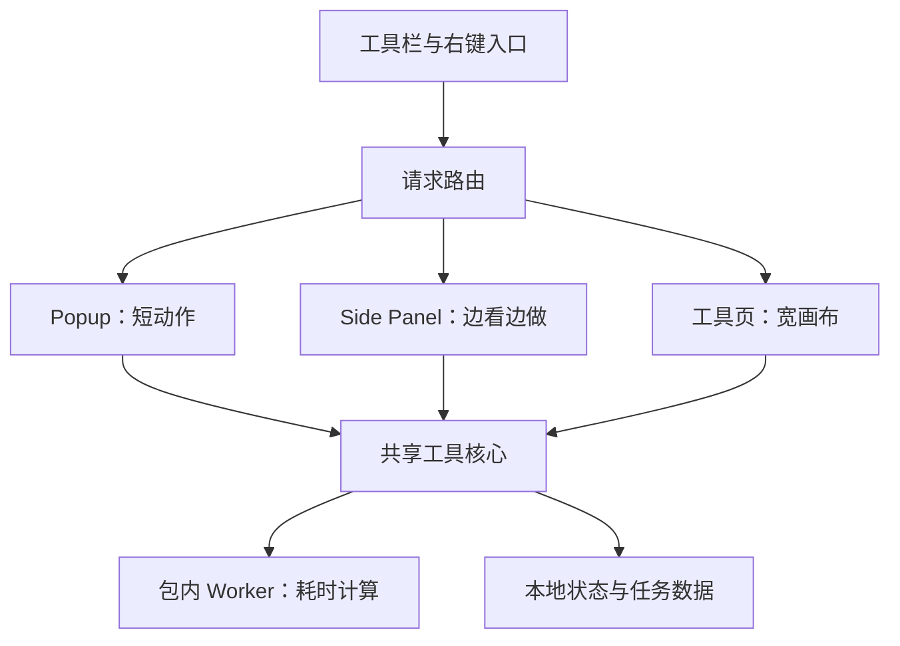

# FToolset：uTools 大众工具迁移调研与开发建议

**调研日期：2026-11-23（Asia/Shanghai）**  
**适用项目：WXT + React + TypeScript + Tailwind CSS，Chrome Manifest V3**  
**基线：已有二维码生成器；现有权限 activeTab、storage、contextMenus；优先纯本地、中英双语。**

## 决策摘要

最值得优先评估开发的六项是：**文字整理、二维码增强、网页取色、常用语、日常计算、常用单位换算**。其中二维码属于已有工具增强，因此实际是“五个新增工具 + 一个已有工具扩展”。首轮先落实前四项；计算和单位换算在明确其与首版用途的关联、目标用户需求后，再决定实施及同批发布。

这份报告形成 **22 个用户任务候选**，供分阶段选择；它们并不等于 22 个独立市场插件，也不应全部成为首页图标。图片压缩、尺寸、拼接和标注需要共享底层能力；颜色取样与图片配色也应共享一个入口。

有一项必须先影响产品范围：**CWS 的单一用途要求与权限多少是两个不同问题。** 官方允许在狭窄主题下提供相关功能，但“效率工具箱”这个名字本身不足以证明任意功能都属于单一用途。建议先围绕“用户主动选择的网页内容，在本地整理后复制或分享”形成一致的产品体验；计算、单位、密码、时间及专注功能需要逐项说明其关联，关联不足的延后或拆分产品。下文 P0/P1/P2 是需求与工程优先级，不代表全部组合一定能过审。[T16]

**证据边界：**本次是公开市场页面、官方技术文档与依赖作者文档研究；未安装逐个实测 uTools 插件，也未读取 FToolset 源码、测量实际包体或验证商店审核结果。下面的开发难度、使用频率、性能预算均为产品/工程判断或拟定目标，不是已测数据。

## 1. 调研方法与大众化筛选标准

### 1.1 扫描范围与取证方法

先查看 uTools 市场入口、“最受欢迎”专题，再覆盖高效办公、记录想法、图像视频、系统工具、好好学习、程序员必备六类专题，交叉核查 26 个不同插件的公开详情，形成以下用户任务分类。[M01][M02][M03][M04][M05][M06][M07][M08]

| 功能领域 | 重点查看的需求 | 浏览器迁移关注点 |
|---|---|---|
| 日常办公与文本 | 字数、复制后的排版、常用回复、两版文字差异 | 选中文字右键进入、少输入、输出可直接复制 |
| 图像与配色 | 取色、图片变小、格式、尺寸、拼接、标注、配色 | 当前网页视觉素材、上传前处理；不默认抓取所有图片 |
| 计算与换算 | 四则、折扣、常见单位、日期差 | 将网页上的数值直接带入，减少切换 |
| 时间与专注 | 世界时钟、跨时区会议、待办、番茄钟 | 判断是否需要常驻，以及关闭 Popup 后的任务行为 |
| 记录与学习 | 常用语、随手记、正文提取、PDF 页整理 | 边看边记、来源可追溯、本地存储 |
| 隐私与安全 | 随机密码、用户主动保存的片段 | 只保留必要能力；不扩成密码保险库或系统剪贴板采集器 |
| 系统与开发类排除对照 | 文件搜索、系统贴图、RPA、编码工具 | 分辨 uTools 宿主优势与 Chrome 沙盒边界 |

“全面”在本报告中指跨类别系统筛选，不表示对市场数千款应用进行了全量安装测试。

### 1.2 怎么理解“热门”和“高口碑”

采用三个证据信号：官方热门专题收录、详情“用户”字段、评分及评分人数。三者分别记录，不合并成虚构的市场排名。

- “用户”沿用市场页面字段，**不解释为日活、月活、下载量或当前活跃安装量**。
- 评分必须和样本数一起看；5.0 分/11 个评分不能直接压过 4.7 分/806 个评分。
- 以下是调研时返回的网页快照；不同 URL 和缓存时间可能不同，不保证是同一秒的实时数据。
- uTools 主要受众与全球 Chrome 普通用户并不完全相同；桌面市场热度只是需求线索。
- 未逐条读取评论正文，因此“口碑”指公开评分信号，不是已完成用户评论主题分析。

| 真实 uTools 插件 | 页面用户数 | 评分 / 评分人数 | 对 FToolset 的证据意义 |
|---|---:|---:|---|
| 计算稿纸 | 2,801,168 | 4.7 / 192 | 日常计算有强市场使用信号；浏览器差异化仍需靠选中数值和贴心计算模式。[U02] |
| 备忘快贴 | 2,167,704 | 4.6 / 190 | 常用内容复用值得重点考虑；不等于需要复制系统自动粘贴能力。[U07] |
| 颜色助手 | 481,293 | 4.6 / 114 | 色值、色卡及收藏有需求；不能把整个插件用户数归因于单一取色功能。[U09] |
| 文本处理 | 15,394 | 4.9 / 15 | 可借鉴文本处理流程，但评分样本较小。[U01] |
| 二维码助手 | 253,550 | 3.6 / 46 | 规模较大，不能归类为高口碑；适合扩展现有二维码入口。[U05] |
| 单位换算 | 16,937 | 4.4 / 9 | 有真实需求，口碑样本有限。[U03] |
| 万物皆可对比 | 28,593 | 5.0 / 38 | 纯文字对比有积极口碑信号；无需复制其完整文件对比范围。[U06] |
| 图片批量处理 | 219,629 | 4.3 / 60 | 压缩、尺寸、格式等任务值得保留。[U11] |
| Markdown 笔记 | 634,615 | 4.7 / 806 | 记录需求有较充分评分样本；大众版应隐藏 Markdown 学习门槛。[U14] |
| ToDo 待办 | 428,370 | 4.6 / 141 | 待办与专注有市场基础，适合后期评估常驻形态。[U12] |
| PDF 处理 | 403,748 | 4.1 / 66 | PDF 需求存在，但必须缩小到前端可靠实现的子集。[U13] |
| 长图拼接 | 35,716 | 4.8 / 59 | 拼接说明图、聊天截图有清晰需求。[U17] |
| 轻快标图 | 12,760 | 5.0 / 35 | 箭头、文字、遮挡等轻标注值得借鉴。[U18] |
| Emoji 表情搜索 | 5,680 | 5.0 / 11 | 作为便利补充，不能凭小样本高分判断为首版爆款。[U19] |
| 时间计算器 | 6,126 | 4.8 / 6 | 日期差和日期加减实用，但评分证据有限。[U04] |
| 世界时钟 - 时区转换器 | 1,244 | 有效评分不足 | 页面显示“2 个评分、0 分”，不作真实低分判断，仅作功能参考。[U08] |

另外两处证据冲突须保留：

1. “屏幕取色工具”有明确取色描述，但本次详情仅 3,126 位用户，显示“2 个评分、0 分”；它提供功能参考，不能借用“颜色助手”的评分包装成该取色器的口碑。[U10]
2. 热门专题中的“密码管理器”描述为官方产品并含随机密码生成，但同名详情打开后是其他开发者的 311 用户版本。因此本报告不采信它的精确热度数字，仅保留随机密码生成这一功能映射。[M02][U26]

### 1.3 五维筛选标准

| 维度 | 本报告的判断规则 |
|---|---|
| 大众普适性与频率 | 普通人能否用一句话理解；是否有反复出现的具体任务；“某群体高频”与“全民高频”分开 |
| 浏览器增益 | 能否少一次复制、少开一个网站，或利用用户刚选中的文本、链接、当前页画面 |
| 纯前端可行性 | 在列明的 MVP 范围内，无服务器、无远程执行代码；采用原生 API 或包内依赖 |
| 权限与合规 | 所需数据是否由用户主动提交；新增权限是否必要；同时检查单一用途及隐私披露 |
| UI 适配 | Popup 用于短动作；持续对照使用 Side Panel；宽画布/批处理使用独立扩展页 |

“3 秒完成”只针对已有输入、已选中文字或已保存模板的常见路径，不包含首次配置、长文本审阅、找文件和大图处理。不会为了满足时间口号省掉必要的结果确认。

### 1.4 淘汰红线

- 纯开发工具：正则调试、JWT 解析、Cron 表达式、JSON 格式化、Base64、哈希、Unix 时间戳等。
- 必须调用服务器才能成立的核心能力：实时汇率、天气、热搜、在线翻译、云 OCR、云图片压缩等；不把“由用户填 API Key”误称纯本地。
- 强绑定特定国内生态的功能：微信专用排版、本土网盘解析、国内发票/政务专用格式等。
- 为一个小功能默认索取全站宿主、历史记录、系统剪贴板读取等广泛访问。
- 依赖本机守护进程、任意文件系统扫描、系统命令或跨应用键鼠控制。
- 需要大模型、大型视频转码引擎或复杂编辑器才能达到宣传效果，且与“轻量开箱即用”不匹配。
- 把无需学习的普通任务包装成需要配置表达式、脚本和专业术语的界面。

## 2. 候选插件分级矩阵（22 个用户任务）

### 2.1 表格口径

插件名称列采用“FToolset 建议名称 ← uTools 参照”，避免把新设计误认为真实市场插件名称。正文提取明确标为浏览器衍生能力。

权限缩写：

- **0**：不新增 Manifest 权限。用户主动粘贴、选文件、点击复制仍需对应交互条件。
- **C / A / L**：使用已有 contextMenus / activeTab / storage。
- **+S**：新增 scripting，仅用于主动触发的页面注入。
- **+SP**：实际采用 Side Panel 时新增 sidePanel；表中推荐侧栏不代表现在就要申请。
- **+AL / +N**：新增 alarms / 可选 notifications。
- 每行“低/中”仅表示该功能的权限与数据处理成本；整体单一用途风险另行评估。

UI 中“快”表示常见短路径适合约 3 秒内完成；“入口”表示 Popup 负责启动，不应在其中完成全部工作。难度包含功能边界与状态处理，低/中/高是相对工程判断。

### 2.2 P0：优先落地，短交互和低成本验证

| 插件名称 | 分类 | 一句话核心价值 / 频度判断 | 浏览器场景亮点 | 推荐技术方案 / 库 | 所需权限 / 成本 | UI 形态建议 | 难度 |
|---|---|---|---|---|---|---|---|
| **01 文字整理与字数 ← 文本处理** [U01] | 文本 | 复制内容立即变整齐；办公、学生广泛且较高频 | 选中段落右键统计、清理，再复制 | 字符串处理、Unicode 属性转义、Intl.Segmenter | 0；右键 C，临时输入 L；低 | Popup 快；长文可放大 | 低—中 |
| **02 网页取色 ← 颜色助手 + 屏幕取色工具** [U09][U10] | 配色 | 把看到的颜色用于 PPT/配图；创作者高频，大众中频 | 不用离开网页或打开开发者工具 | EyeDropper、原生 HEX/RGB；进阶 culori/fn | 0；收藏 L；低 | Popup 快；提供稳定工具页后备 | 低—中 |
| **03 二维码识别与分享 ← 二维码助手** [U05] | 链接 | 把链接变二维码、把二维码还原成文字；通用中频 | 当前标签页一键生成；链接右键生成 | 复用现有生成器；jsqr；Canvas；BarcodeDetector 可选 | A/C/L；文件识别 0；低 | Popup 快；图片选择路径可放大 | 中 |
| **04 日常计算与折扣 ← 计算稿纸** [U02] | 计算 | 快算总价、折扣和比例；通用中高频 | 网页选中的金额作为起始数值 | decimal.js-light + 固定计算模式/小型四则语法 | 0；选文 C；低 | Popup 快 | 低—中 |
| **05 常用单位换算 ← 单位换算** [U03] | 换算 | 看懂尺寸、重量、温度；购物/学习中频 | 选中“12 in”等直接带入 | 常量和公式；扩展时按量纲导入 convert-units | 0；选文 C；低 | Popup 快 | 低 |

P0 是“更值得优先验证”的判断。取色在设计/创作人群更高频，单位换算偏场景需求；现有证据不支持把它们宣传成人人每天必用。

### 2.3 P1：复用与网页上下文，形成持续使用理由

| 插件名称 | 分类 | 一句话核心价值 / 频度判断 | 浏览器场景亮点 | 推荐技术方案 / 库 | 所需权限 / 成本 | UI 形态建议 | 难度 |
|---|---|---|---|---|---|---|---|
| **06 常用语 ← 备忘快贴** [U07] | 办公 | 常用回复、介绍、地址不必重复写；办公高频 | 选文收藏；填表/回邮件时点击复制 | React、chrome.storage.local；纯文本检索 | C/L；低—中，保存用户内容 | Popup 快；批量管理用侧栏/工具页 | 低—中 |
| **07 两段文字找不同 ← 万物皆可对比** [U06] | 文本 | 快速看见两版通知或文稿改了哪里；写作人群中高频 | 将网页选文加入“原文”或“新版” | diff；Intl.Segmenter；大输入用包内 Worker | C/L；低 | Popup 入口；长文侧栏/工具页 | 中 |
| **08 强密码生成 ← 密码管理器中的生成能力** [M02] | 安全 | 注册时生成难猜密码；覆盖广但频率有限 | 在注册页面旁生成并手动复制 | crypto.getRandomValues；拒绝采样 | 0；不保存生成结果；低权限、敏感输出 | Popup 快 | 低—中 |
| **09 世界时间与时区 ← 世界时钟 - 时区转换器** [U08] | 时间 | 避免约错海外时间；跨国协作群体高频 | 在会议/课程页面旁对照 | 当前时刻用 Intl.DateTimeFormat；任意当地时间转换用 Temporal / @js-temporal/polyfill | 0；偏好 L；低 | Popup 快；多城市排期侧栏 | 中 |
| **10 日期与天数 ← 时间计算器** [U04] | 时间 | 看截止日、相差天数；办公/学生中频 | 选中日期作为起点，明确是否计入首尾 | 日期字段、UTC 日历日期运算；可用 date-fns 的相关函数 | 0；选文 C；低 | Popup 快 | 低—中 |
| **11 表情与常用符号 ← Emoji 表情搜索** [U19] | 输入 | 找到 ✓、→、© 和常用表情；输入场景中频 | 浏览器内搜索复制，适合写邮件和文案 | Unicode 字符 + 精简中英关键词 JSON | 0；收藏 L；低 | Popup 快 | 低 |
| **12 网页可见区截图 ← 兔灵截图工具的浏览器子集** [U15] | 网页 | 保存当前看到的内容；办公沟通中高频 | 用户点击后直接截当前页画面 | chrome.tabs.captureVisibleTab；Canvas | A；不需 tabCapture/desktopCapture；中，涉及页面图像 | Popup 预览/保存；编辑进工具页 | 中 |
| **13 网页正文提取 ← 笔记/摘录需求的浏览器衍生** [U14] | 学习 | 将当前文章整理成纯文字；阅读研究人群中频 | 不必手工绕过导航、广告和推荐区选择文字 | @mozilla/readability；优先 textContent；HTML 展示另用 dompurify | A + 新增 S；中，读取页面内容 | Popup 入口；侧栏/工具页 | 中—高 |

“常用语”列 P1 是因为涉及保存、管理和重复使用，**仍进入首批 Top 6**。表情符号可作为便捷补充，但系统输入法已覆盖部分需求。正文提取不是已验证的 uTools 热门同名插件。

### 2.4 P2：媒体处理与持续任务，按实际空间选择容器

| 插件名称 | 分类 | 一句话核心价值 / 频度判断 | 浏览器场景亮点 | 推荐技术方案 / 库 | 所需权限 / 成本 | UI 形态建议 | 难度 |
|---|---|---|---|---|---|---|---|
| **14 图片变小与转格式 ← 图片批量处理** [U11] | 图片 | 上传前减小图片；办公创作者较高频 | 网页上传流程旁处理本地文件 | createImageBitmap、Canvas.toBlob / OffscreenCanvas；目标大小可评估 browser-image-compression | 文件输入 0；低；不承诺任意 CDN 原图读取 | Popup 入口；侧栏队列或工具页 | 中 |
| **15 图片尺寸与裁剪 ← 图片批量处理** [U11] | 图片 | 做符合表单/PPT要求的图片；办公创作者较高频 | 按目标宽高一次调整 | Canvas；高质量缩放 pica；简洁裁剪框 | 0；低 | 宽工具页优先；侧栏可选 | 中 |
| **16 图片拼接 ← 长图拼接** [U17] | 图片 | 多张截图拼成一张说明图；办公创作者中频 | 处理已保存/粘贴的网页截图 | Canvas / OffscreenCanvas；包内 Worker | 0；任务存储 L/IndexedDB；低 | 工具页优先；Popup 入口 | 中 |
| **17 图片标注与遮挡 ← 轻快标图** [U18] | 图片 | 画箭头、框重点、盖住信息；办公沟通较高频 | 承接第 12 项截图，处理后直接导出 | Canvas 或 SVG 编辑层，最终扁平化为位图 | 本地输入 0；截图 A；中 | 工具页优先；简单操作侧栏 | 中 |
| **18 从图片找配色 ← 颜色助手** [U09] | 配色 | 从参考图选出几种主色；设计/创作中频 | 在网页参考素材旁整理配色 | 缩略图采样 + colorthief；颜色管理复用第 02 项 | 本地输入 0；收藏 L；低 | 少量色卡可 Popup；多图侧栏/工具页 | 中 |
| **19 随手记 ← Markdown 笔记** [U14] | 记录 | 边看网页边记录；有记录习惯者高频 | 手动附当前页标题/网址和选文 | textarea / 轻量格式；storage.local；需要附件时 IndexedDB | L；主动取来源 A/C；中，持久保存内容 | Side Panel 优先，新增 SP | 中 |
| **20 轻待办 ← ToDo 待办** [U12] | 任务 | 把看到的事情变成待办；目标用户高频 | 选中文字右键建一条带来源的任务 | React、storage.local / IndexedDB | C/L；侧栏新增 SP；中 | Popup 快速新增，Side Panel 管理 | 中 |
| **21 专注计时 ← ToDo 待办 / 休息一下** [U12][U16] | 专注 | 开始一段专注时间；习惯型用户高频 | 不离开学习/工作页面查看进度 | deadline + chrome.alarms；UI 重新计算剩余时间 | L + 新增 AL；提醒可选 N；侧栏 SP；中 | Popup 启动；侧栏可选，后台调度独立 | 中 |
| **22 PDF 合并与拆页 ← PDF 处理** [U13] | 文档 | 把文件合为一份、提取所需页；办公阶段性高频 | 收到文件后就地处理再上传 | pdf-lib；需要页缩略图再按需加入 pdfjs-dist | 用户选文件 0；低权限、中等文档敏感性 | 独立工具页优先；侧栏仅任务摘要 | 中—高 |

这 22 项均可在明确的 MVP 子集内采用纯本地方案。限制来自输入来源、格式、性能与权限，不是把桌面插件的全部宣传功能原样搬入浏览器。

### 2.5 关键实现边界

**图片读取与编码。** 右键事件的 srcUrl 只是图片地址，不代表拥有跨域 CDN 原图读取权限；网页能显示图片，也不意味着扩展可读取其像素。首批用用户选文件、主动粘贴或当前可见区截图。原生 Canvas 先支持 PNG/JPEG/WebP；检查实际 Blob MIME、透明背景、图片方向和最大像素数。PNG 的 quality 参数不是通用有损压缩器，Canvas 单帧导出也不能承诺保留 GIF 动画。[T14][T20][T21]

**图片库接入。** browser-image-compression 默认 Worker 路径会使用 CDN libURL；不能照抄网页示例。可在自建包内 Worker 中运行并禁用库内 Worker，或将 Worker 及其依赖全部改成已验证的包内 URL。pica 的 Worker/WASM 也需要与 CSP 一起检查。压缩结果更大时保留原图，不宣传“任何图片都能缩小”。[T29][T30]

**密码。** 只生成，不托管账号或自动填写。使用 crypto.getRandomValues；随机数到字符集的映射采用拒绝采样，避免简单取模造成分布偏差。密码不进最近内容、日志、持久存储；剪贴板是用户主动导出的边界，不许承诺复制后不存在其他软件读取的可能。[T19]

**时区与日期。** Intl.DateTimeFormat 适合把同一时刻显示到不同 IANA 时区；它不是任意当地时间的通用解析器。支持会议日期时，使用 Temporal 的时区语义或包内 polyfill，并处理夏令时重复/不存在的当地时间。日期差按日历日期处理，不用本地时间差直接除以 24 小时；法定工作日会涉及各地节假日数据，首版不承诺。[T34][T35]

**正文与 PDF。** Readability 不能保证所有网站成功；它会修改传入文档，应先克隆 DOM，再调用 new Readability(document.cloneNode(true)).parse()，不直接处理当前网页的 live document。输出 HTML 也未经安全净化，默认只展示纯文本。pdf-lib 适合页级操作，不负责通用 PDF→Word、普通页面正文提取或所有 PDF 压缩；加密 PDF 在 MVP 中明确不支持。PDF 缩略图的 PDF.js 是另一笔包体成本。[T31][T32]

## 3. Top 6 推荐插件深度拆解

以下是功能适配与工程投入的推荐顺序。前四项优先验证网页内容处理的核心体验；计算和换算先明确与首版用途的关联及用户需求，再进入实现，不因成本低就默认加入同批发布范围。

### 3.1 文字整理与字数统计（Text tools）

**为什么先做：**能直接承接选中的网页文字，与办公、学习、创作均有关；不必增加页面注入权限。

**MVP：**

- 字符数、单词数、段落数；中文界面默认突出字符数，并说明计数口径。
- 去除首尾空白、清理重复空格、清理多余空行。
- “整理从 PDF 复制的文字”作为明确可选模式；保留段落边界，不默认合并全部换行。
- 英文大小写切换；保留原文、一键撤销、复制结果。
- 纯文本输入与纯文本输出。

**进阶贴心功能：**行去重、列表编号清理、按语言处理断行、保留常用清理组合。对格式敏感的诗歌、地址和代码允许直接保留原样。

**交互：**选中文字 → 右键“FToolset → 整理文字” → Popup 已填入文本并显示字数 → 点清理预设 → 点复制。直接从工具栏打开时，用户自己粘贴；不默认读取剪贴板。

**技术与 MV3：**

- contextMenus 的 selectionText 已包含选区文本，不需 scripting；若日后要求工具栏点击后直接读取页面选区，则需要额外的 scripting 路径。[T02]
- Intl.Segmenter 的 grapheme 用于用户感知字符，word 用于单词分段；中文汉字计数与词数分开。text.length 只是 UTF-16 单元数量，不能充当用户感知字符数。[T18]
- 短文本用纯函数；长文本按规模交给包内 Worker，保留取消。
- 点击复制时调用 navigator.clipboard.writeText；复制失败显示可选中的结果，不静默宣告成功。[T07]

**验收重点：**中英混排、emoji 家庭序列、组合音标、连续空行、诗歌换行和撤销；右键任务与当前工具状态不串内容。

### 3.2 二维码识别与分享（QR tools，现有工具增强）

**MVP：**

- 保留现有生成器；增加“当前网页”“输入文字/链接”“识别图片”三个入口。
- 从当前标签页获得标题和网址；对链接右键生成该链接二维码。
- 粘贴图片或选择本地图片识别。
- 输出识别内容；网址显示明确的“打开链接”按钮，不自动跳转。
- 导出二维码为 PNG，长文本或失败情况给出可理解的提示。

**进阶贴心功能：**粘贴截图识别、多种缩放重试、旋转处理；可见区截图识别。多码场景需让用户选目标，不把单码库包装成一次识别所有码。

**交互：**在网页右键链接 → “生成二维码” → 直接显示；或把二维码图片粘到 Popup → 显示文字/网址 → 复制。选择文件及系统对话框的生命周期要实测，必要时在稳定工具页完成导入。

**技术与 MV3：**

- npm 名称是 **jsqr**，项目名称是 jsQR；它接收 RGBA 像素数组。已有生成器继续复用，避免再引入第二套编码库。[T27]
- BarcodeDetector 只作为能力检测后的快速路径，检查存在性及 getSupportedFormats() 是否含 qr_code；保留 jsqr 回退。[T37]
- 当前页元数据可在用户触发后的 activeTab 范围读取，不需要为此增加 tabs 或全站权限。[T01][T03]
- srcUrl 不能保证跨域原图可读；不通过代理服务器绕过 CORS。[T14]

**验收重点：**中文内容、长 URL、反色/低清图片、非二维码、损坏文件；拒绝自动执行 javascript: 等非预期协议，HTTP(S) 也由用户明确点击打开。

### 3.3 网页取色（Pick a color）

**MVP：**

- 一个醒目的“从屏幕取色”按钮。
- 大色块预览，HEX 和 RGB 复制。
- 手动输入色值，保存少量用户收藏。
- Esc 取消是正常流程，保留上一次结果。

**进阶贴心功能：**最近取色、给颜色命名、导出小色卡、从图片提取主色。AI 配色与大色卡全集不进入 MVP。

**交互：**打开工具 → 点取色 → 选网页像素 → 回到色值结果 → 点复制。这个能力也可取到屏幕其他区域的颜色；产品重点仍是帮助用户把网页上的视觉参考用到文档和创作中。

**技术与 MV3：**

- 使用 new EyeDropper().open()，不需要 activeTab、scripting、摄像头或屏幕录制权限；API 要求明确用户动作。[T06][T38]
- 取色按钮直接调用 open()；不要先等待重型异步 import 再调用，否则可能丢失短暂用户激活。
- 返回的是屏幕像素 sRGBHex，不是 DOM 元素原始 CSS 色值；透明叠加、渐变和图片都会影响显示色。[T06]
- HEX/RGB 互转原生即可；确实需要更多颜色空间时使用 culori/fn 并只注册必要模式，默认 culori 全入口不保证按使用量裁剪。[T33]
- Popup 失去焦点会关闭；原生取色交互的实际表现必须在 Windows/macOS 验证，不能仅凭一般生命周期规则判断一定成功或一定失败。提供独立取色页作为后备。[T05]

**验收重点：**点击取色、Esc、连续取色、多屏与缩放、Popup 状态恢复；复制错误可见。

### 3.4 常用语（Saved snippets）

**MVP：**

- 每条片段只有标题、内容、收藏状态。
- 选中文字右键“存为常用语”；允许编辑标题后保存。
- Popup 搜索、按收藏排序、点击复制。
- 编辑、删除、导出/导入本地备份。
- 保存敏感内容前提示其为本地普通存储；不把它宣传为密码保险库。

**进阶贴心功能：**“收件人姓名”等少量显式占位符、多语言片段、轻分类；从选区附上可选来源链接。避免一开始引入通用模板语言。

**交互：**网页选文收藏一次；以后回邮件或填表时，打开扩展搜索几个字，点复制。首版不修改网页输入框，减少框架兼容、焦点丢失和额外权限问题。

**技术与 MV3：**

- 使用 chrome.storage.local；纯本地承诺下不使用 storage.sync。[T08]
- 普通文本用 textarea 和 React 转义渲染，不把用户片段当 HTML 注入。
- 每条记录独立 ID/key，避免每次更新整个数组。若用 storage.local，全部更新统一经过后台的串行写入者并检查 revision；若需要多视图事务保证，将内容迁到 IndexedDB，在同一事务内完成读取、revision 校验和写入，冲突时保留两版。单独增加 revision 字段无法防止并发覆盖。
- 显式点击复制，手工粘贴；“自动输入到当前网页”是独立的后续能力，不混进 MVP。

**验收重点：**重启后保留、导入错误不破坏现有数据、删除可恢复或明确确认、多窗口不丢更新、没有后台剪贴板采集。

### 3.5 日常计算与折扣（Quick calculator）

**MVP：**

- 四则运算、大号结果、复制。
- “打几折/优惠百分之几”“A 是 B 的百分之几”“增加/减少百分之几”采用固定表单。
- 选中网页数值带入第一输入项。
- 最近几步结果只在当前会话保留。

**进阶贴心功能：**少量计算过程、继续基于结果计算、多行求和；如果确有需求，再增加括号表达式。

**交互：**网页选中 199 → 右键“快速计算” → 选择“优惠 20%” → 显示支付 159.2。中文“打八折”和英文“20% off”统一表达为同一个计算语义。

**技术与 MV3：**

- decimal.js-light 处理十进制算术；它不是表达式解析器，需要自己实现受限语法，或以按钮状态机和固定字段完成 MVP。[T26]
- 不用 eval 或 new Function 计算用户输入，保持 MV3 CSP 可用。[T13]
- 百分比按钮的语义必须明确，不能让“100 + 10%”有多种未说明解释。
- 除零、无穷大、超长输入、舍入规则和本地化数字格式需要可见处理；不做金融计算器的精度承诺。

**验收重点：**0.1 + 0.2、连续运算、负数、除零、百分比/折扣、复制实际结果；“1,234”类输入采用明确的语言/地区规则，不猜测。

### 3.6 常用单位换算（Unit converter）

**MVP：**

- 长度：cm、m、inch、ft。
- 重量：g、kg、oz（质量）、lb。
- 温度：℃、℉。
- 容量：mL、L；确有全球场景再加明确标注体系的加仑/液盎司。
- 输入数值、选择两端单位、交换、复制。

**进阶贴心功能：**记住最近单位；对“12 in”“5 kg”等明确格式的选文自动识别；增加面积/速度等已有反馈需求。

**交互：**网页选中“12 in” → 右键“换算单位” → 显示“30.48 cm”；识别不确定时，让用户选单位，不给出猜测结果。

**技术与 MV3：**

- 小范围使用显式常量/转换函数更容易控制包体和口径；功能扩展再用 convert-units，按量纲导入所需 definitions，避免 allMeasures。[T25]
- 温度按带偏移的公式处理；质量和体积不能互换。
- 美制/英制容量、质量 oz 与 fl oz 分开；不把 mL 到 g 当作通用转换。
- 实时汇率不属于这套纯离线能力；px↔cm 若加入，必须由用户明确 DPI。
- 无需位置权限，单位偏好由用户选择和本地保存。

**验收重点：**温度负值、双向换算、单位体系、舍入与极值；使用固定权威常量，UI 名称中英一致。

## 4. 明确“不建议复刻”的 uTools 热门插件清单

以下 8 项/工具族提供明确排除依据。“不建议”针对 FToolset 当前定位，并不评价原插件质量。

### 4.1 技术受限类：桌面宿主优势难以等价迁移

| 插件 | 热门/功能依据 | 不建议迁移的部分 | FToolset 可保留的边界 |
|---|---|---|---|
| **剪贴板** | 官方热门；约 259 万页面用户。[U21][M02] | 系统剪贴板历史、持续监听、跨应用粘贴；与最小权限及隐私预期冲突 | 只保存用户明确收藏的文本，不后台轮询剪贴板 |
| **本地搜索** | 官方热门；基于 Everything。[U20][M02] | 整机文件索引、任意路径读取；纯浏览器无法复制宿主能力 | 用户通过文件选择器明确选择文件后处理 |
| **悬浮 / 系统截图贴图** | 官方热门；支持图片置顶、透明度等。[U22][M02] | 任意桌面应用上方长期贴图、系统级窗口控制和无感截图 | 当前网页可见区截图、浏览器内参考页；不宣传系统贴图替代 |
| **快捷命令的系统自动化部分** | 官方热门列表包括系统脚本、键鼠等能力。[M02] | Shell/Python、系统文件批处理、跨应用 RPA；通常需要额外本机组件 | 仅做扩展内部固定操作，不开放脚本执行平台 |

Chrome 可做截图，现有 activeTab 也能调用 captureVisibleTab；这里排除的是桌面截图工具的完整系统体验。用户确认的屏幕捕获是另一种产品范围，不应混为“Chrome 完全不能截图”。[T03]

### 4.2 受众错配类：技术可行，但不值得挤占大众首页

| 插件 / 工具族 | 为什么不推荐 | 可迁移的经验 |
|---|---|---|
| **Ctool / 正则、JWT、Cron、JSON 等开发工具** | 名称与任务本身要求专业知识，违背非程序员定位；Ctool 明确定位程序开发工具。[U24] | 复用模块化思路，不迁入开发菜单 |
| **编码小助手 / Base64、哈希、Unicode 编码** | 普通用户极少需要，而且“哈希=加密”等误解需要额外解释；位于官方热门列表并不能改变受众错配。[M02] | 将确有需求的文字转换用普通语言呈现 |
| **时间戳转换** | Unix 秒/毫秒是开发任务，不能用它替代大众时区和日期工具。[M02] | 做“日期与天数”“世界时间” |
| **网页快开** | 桌面启动器里价值强，迁到 Chrome 后与地址栏、书签重叠；多浏览器启动优势也减弱。[U25] | 收藏和搜索的短路径设计 |

**另外的范围判断：**OCR 文字识别有强市场需求，官方详情显示约 335 万页面用户，但本地中英模型、性能、语言包与准确率验证超出首批轻量路线；它不是“技术完全不可行”，应作为独立实验再决策。[U23] 在线翻译、在线 TinyPNG、AI 生成、实时汇率不满足本轮纯本地核心约束；视频转码和全量 PDF→Office 则不应被包装成几天即可完成的小工具。

## 5. 大众版 FToolset 产品体验与架构建议

### 5.1 Popup 超过 10 项后：按用户想做的事导航

建议首页保持四层，从上到下：

1. 搜索框：“想做什么？例如：数字数、图片变小、取颜色”。
2. 当前明确上下文的一个推荐入口，例如刚通过右键提交的文字；普通打开时不被动扫描网页。
3. 4–6 个用户置顶工具；默认放已上线且符合首版范围的核心入口。
4. “文字、图片、计算、时间”等少量类别及“全部工具”；若后期功能尚未发布，不提前显示空分类。

收藏决定位置；最近使用只记录 toolId 和时间，不保存最近处理的原文、网址、密码或文件缩略图。一个操作任务只对应一个主入口；把清空格、去换行、统计字数放进“文字整理”。

搜索先用几十条名称/关键词的原生匹配，无需引入全文搜索引擎。别名同时覆盖“字数 / words / word count”“压缩 / 图片变小 / compress”等表达。输入中英文都能定位同一工具。

建议 Popup 约 380–440 px 宽，根据实际界面测试；Chrome 允许的尺寸上限是 800×600，不应把上限当作默认设计目标。[T04] 每个工具保持“输入—结果—主要动作”，高级选项折叠；长任务提供“放大打开”。

### 5.2 统一右键入口，保证数据和触发链路可预测

选中文字时显示“整理文字、加入对比、存为常用语”；链接上下文显示“生成二维码”；页面上下文按已上线功能显示截图等。每种上下文只放少量相关项。

建议流程：

- 从 contextMenus.onClicked 拿到 selectionText / linkUrl / pageUrl。
- 建立 requestId，记录 toolId、tabId、windowId、createdAt、短期 payload。
- 文本暂存在 storage.session；Popup URL 或工具页 URL 只带随机 requestId，不带原文或敏感网址。
- Chrome 127+ 可调用 action.openPopup；该方法不接收 URL 或 requestId 参数。建议 Popup 打开后向后台认领按窗口/标签隔离的待处理请求；也可先用 action.setPopup 设置该 tab 的包内路径和 requestId，消费后恢复默认路径。失败或较旧版本可打开包内 tool.html。新标签页创建本身不要求 tabs 权限。[T02][T03][T04]
- 消费成功后移除任务；取消或过期及时删除。新请求不能悄悄覆盖用户正在编辑的旧输入。
- 不依赖 SW 全局变量永久保存任务；持久数据与临时数据分开。[T08][T11]

activeTab 由明确用户动作触发，跨站导航后可能失效。侧栏打开或切到另一个标签页，并不意味着扩展自动获得了新页面的 DOM 权限。DOM 注入对 chrome://、商店等受限页面有边界；截图 API 对部分受限页面有不同规则，错误提示应按能力区分。[T01][T03]

### 5.3 按需加载：首页只加载导航和正在使用的工具

推荐拆分：

- app-shell：导航、搜索、轻量公共组件、当前语言。
- tool-registry：名称、关键词、分类、上下文入口、支持容器、loader。
- tools/*：纯业务核心与具体 UI。
- adapters/*：Chrome API、剪贴板、文件和存储。
- workers/*：图像计算、长文本比较、PDF 等耗时任务。
- entrypoints/popup、sidepanel、tool.html：复用组件，不复制三份实现。

示意：

```ts
const toolRegistry = [
  {
    id: 'text',
    titleKey: 'tools.text',
    keywords: ['字数', '空格', 'word count', 'clean text'],
    load: () => import('./tools/text/Tool'),
  },
  {
    id: 'color',
    titleKey: 'tools.color',
    keywords: ['取色', '颜色', 'color picker'],
    load: () => import('./tools/color/Tool'),
  },
];
```

在组件层缓存 React.lazy 的结果，使用 Suspense 的轻量占位。不要用一个 barrel 文件静态导出所有工具后再期待懒加载；不要将 import.meta.glob 配成 eager: true。大图标包只导入用到的图标，首版不用 Monaco、完整富文本编辑器、全量数学库和整套图表库。

WXT 的 HTML 入口使用 ESM，可做代码分割；**MV3 Service Worker 不支持动态 import()，不能把上述 UI 模式原样用于后台**。后台保持轻量，只注册事件、菜单、路由和计时唤醒；耗时运算由工具页和包内 Dedicated Worker 承担。[T10][T22][T23][T24]

代码分割减少首屏加载/执行量，**不会减少所有 chunk 加起来的安装包体**。开发模式的 HMR 表现不等于发行表现，需检查 production 输出。

#### 建议性能预算（项目目标，尚未实测）

| 项目 | 初始目标 | 如何核验 |
|---|---|---|
| Popup 主体出现 | 参考办公设备 P95 ≤ 150 ms | 定义触发到主体绘制的统一计时口径 |
| 首屏可操作 | 冷启动 P95 ≤ 300 ms | 在生产构建、关闭调试器后重复测量 |
| 主入口 JS + CSS | 未压缩合计尽量 ≤ 350 KB | 看构建产物和入口依赖图；gzip 仅辅助 |
| 常见短任务 | 输入就绪后约 3 秒内取得可复制结果 | 文本/取色/转换分别记录，不包含找文件时间 |
| 首批安装 ZIP | 先设 ≤ 2 MB 作为提醒阈值 | 以实际构建为准，图片/OCR另立预算 |
| 网络依赖 | 离线仍可运行已承诺的工具 | 从安装后首次使用开始验证，不靠缓存掩盖 CDN |

每次打开 Popup 都毫秒级可操作是工程目标，不能在未经参考设备测量时写成保证。

### 5.4 三种容器共用核心，任务生命周期分开设计



**Side Panel 不提供页面读取权限，也不是永不关闭的后台。** Popup、Side Panel 和工具页只是不同视图。关闭视图后，依赖该视图的任务可能结束；文件和长任务必须先进入稳定的工具页再开始，或明确告知关闭即取消，不让用户误以为后台还在运行。[T05][T09][T11]

| 阶段 | 建议范围 | 权限与实现条件 |
|---|---|---|
| 阶段 A：Popup 验证 | 文字、二维码增强、取色、常用语；计算与单位按用途关联选择 | 保持基础三权限，完成任务路由、复制、语言切换 |
| 阶段 B：独立工具页 | 文字对比、图片压缩/裁剪/拼接、PDF 页操作 | 不等 Side Panel；开扩展自有页面无需为此申请 tabs |
| 阶段 C：Side Panel | 常用语管理、随手记、文字对比、已证实有需求的待办 | 实际加入时声明 sidePanel；页面提取另外使用 scripting |
| 阶段 D：计时与更重能力 | 专注提醒；OCR 等另做实验 | 计时用 alarms，系统提醒可选 notifications；重能力单独审包体 |

如果只选三项先适配侧栏，推荐 **随手记、常用语管理、文字对比**。它们的价值来自边看网页边操作。图片裁剪和 PDF 页序编辑更依赖宽度，独立工具页通常更合适。

番茄钟保存绝对截止时间 deadline，UI 按 deadline - Date.now() 计算显示；后台一次性 alarm 负责到期处理。设备休眠、浏览器关闭和调度延迟需恢复校验，不用 Popup 的 setInterval 作为唯一计时依据。具体最低版本对应的 alarms 能力在实现时锁定，不把某一版本最短间隔写成永久规则。[T12]

### 5.5 最小权限与本地隐私的实现清单

| 能力 | 首选路径 | 不必默认新增的权限 |
|---|---|---|
| 当前网页标题和网址 | 用户触发后的 activeTab + Tabs API | tabs、history、全站宿主 |
| 右键选中文字/链接 | contextMenus 提供的数据 | scripting |
| 屏幕取色 | EyeDropper | desktopCapture、tabCapture、全站宿主 |
| 输入文本/图片 | 手工粘贴、文件选择器 | clipboardRead |
| 复制结果 | 可见页面中的用户点击 + Clipboard API | 无必要时不申请 clipboardWrite |
| 保存导出文件 | 包内页面创建 Blob + 下载链接 | 无下载管理需求时不申请 downloads |
| 文章正文提取 | activeTab + 按需 scripting | 全站持久宿主 |
| 持续侧栏 | sidePanel | 不因此增加网页访问权限 |

相关 Chrome API 与 Web API 文档见 [T01][T02][T03][T06][T07][T09][T14][T21]。表中“无需默认新增”不代表所有浏览器和交互上下文均无条件成功，应保留失败提示和手工后备路径。

存储建议：

- storage.local：语言、收藏工具、用户主动保存的常用语/轻便签。
- storage.session：右键输入、短任务和暂存结果；过期删除。
- IndexedDB：确有必要保留的 Blob、长任务及需要事务的记录。
- 不使用 storage.sync 来实现“严格不出本地”的产品；云同步需要重新定义隐私承诺。[T08]
- 不把用户内容写入诊断日志；提供清空数据和本地备份入口。普通本地存储不是操作系统级加密保险库。

### 5.6 i18n、依赖与上架

**国际化要覆盖行为。** 界面用中英语言键；商店元数据及 Manifest 的 name/description 使用本地化资源。应用内手动切换语言用自己的轻量字典，避免把浏览器 UI 语言当作唯一选择。

日期、12/24 小时、小数分隔符、时区、单位体系和字符计数口径都需要明确。中文“打八折”与英文“20% off”是同一计算；英文地区也不能都默认美制单位。Emoji 用系统 Unicode 字形，说明不同平台显示可能不同，不打包大套位图表情。

**依赖全部包内。** 所有 JS、Worker、WASM、字体和语言资源进入生产包。动态加载包内 chunk 合法，运行时 CDN JS 或远程 WASM 不满足这套 MV3 方案。确实使用 WASM 时按 Chrome CSP 加 wasm-unsafe-eval；这不是允许普通 eval/new Function 的许可。[T13][T15][T39]

**商店披露与实现保持一致。** 即使完全本地，CWS 也要求说明用户数据的处理方式。应明确仅在操作时读取哪些输入、是否保存、如何清除、是否向外发送；“不上传内容”不应写成“不处理任何数据”。权限声明只覆盖已经实现的功能。[T17]

本报告中的“复刻”指重新实现用户任务和交互价值。原插件不是因能下载安装就允许复制源码、品牌或素材；如采用开源实现，按对应 LICENSE 和第三方依赖要求处理。CWS 开发者协议要求开发者拥有必要权利，禁止侵犯第三方知识产权。[T40]

### 5.7 给开发阶段的验收任务

1. **权限闭环：**生产 Manifest 仅含已启用能力所需权限；基础工具不新增全站宿主或 tabs；无功能提前占用权限。
2. **真实浏览器流程：**Windows/macOS 的右键→Popup、取色→回到结果、文件选择→导入、复制失败等均有实测。
3. **输入正确性：**中文/英文/emoji、温度与单位、百分比、非法数值、日期边界各有与规则对应的样例。
4. **任务生命周期：**Popup 关闭、SW 休眠、多个窗口快速触发、两个视图同时编辑时不丢数据或串任务。
5. **真实离线：**断网首次使用工具仍可运行；没有 CDN Worker、远程脚本、字体或模型依赖。
6. **产品反馈：**先找办公、学生、创作者等不同类型用户观察任务完成过程；用能否独立完成、完成时间和重复使用意愿决定下一批功能，不用候选数量代替价值。
7. **文案一致：**没有把可见区截图写成整页截图，没有把 PNG 转码写成保证压缩，没有把普通本地存储写成密码保险库。

**推荐实施顺序：**先搭好共享输入/复制/短任务/双语底座；完成文字整理和现有二维码增强；验证取色与常用语；随后以明确用途选择计算和单位。待这条路径稳定，再推进图片工作台和侧栏。22 项候选作为路线图保留，首批是否发布各工具以实际用途、体验与验证结果决定。

## 附录 A：主要一手来源

下面的链接对应正文编号，便于开发时复核。市场数字可能随页面更新；技术文档以实现时选定的 Chrome 最低版本和依赖版本再次确认。

### uTools 市场与分类

- [M01] 市场首页
- [M02] 最受欢迎
- [M03] 高效办公
- [M04] 记录想法
- [M05] 图像视频
- [M06] 系统工具
- [M07] 好好学习
- [M08] 程序员必备

### uTools 详情

- [U01] 文本处理；[U02] 计算稿纸；[U03] 单位换算；[U04] 时间计算器
- [U05] 二维码助手；[U06] 万物皆可对比；[U07] 备忘快贴；[U08] 世界时钟 - 时区转换器
- [U09] 颜色助手；[U10] 屏幕取色工具；[U11] 图片批量处理；[U12] ToDo 待办
- [U13] PDF 处理；[U14] Markdown 笔记；[U15] 兔灵截图工具；[U16] 休息一下
- [U17] 长图拼接；[U18] 轻快标图；[U19] Emoji 表情搜索；[U20] 本地搜索
- [U21] 剪贴板；[U22] 悬浮；[U23] OCR 文字识别；[U24] Ctool
- [U25] 网页快开；[U26] 密码管理器同名详情（与热门专题存在身份冲突）

### Chrome、Web API、WXT 与依赖

- [T01] activeTab；[T02] contextMenus；[T03] tabs/captureVisibleTab；[T04] action/openPopup
- [T05] Popup 生命周期；[T06] EyeDropper；[T07] Clipboard API；[T08] storage
- [T09] Side Panel；[T10] Service Worker imports；[T11] Service Worker 生命周期；[T12] alarms
- [T13] MV3 CSP；[T14] 跨域网络请求；[T15] MV3 代码要求
- [T16] 单一用途 FAQ；[T17] 用户数据与最小权限 FAQ
- [T18] Intl.Segmenter；[T19] crypto.getRandomValues；[T20] Canvas.toBlob；[T21] File API
- [T22] WXT entrypoints；[T23] WXT ESM；[T24] WXT 构建分组
- [T25] convert-units；[T26] decimal.js-light；[T27] jsQR/jsqr；[T28] diff/jsdiff
- [T29] pica；[T30] browser-image-compression；[T31] pdf-lib；[T32] Readability
- [T33] culori tree-shaking；[T34] Temporal polyfill；[T35] Intl.DateTimeFormat
- [T36] Color Thief；[T37] BarcodeDetector；[T38] EyeDropper.open；[T39] 远程托管代码规则
- [T40] CWS 开发者协议

[M01]: https://www.u-tools.cn/plugins/
[M02]: https://www.u-tools.cn/plugins/topic/17/index.html
[M03]: https://www.u-tools.cn/plugins/topic/2/index.html
[M04]: https://www.u-tools.cn/plugins/topic/8/
[M05]: https://www.u-tools.cn/plugins/topic/9/
[M06]: https://www.u-tools.cn/plugins/topic/13/
[M07]: https://www.u-tools.cn/plugins/topic/11/
[M08]: https://www.u-tools.cn/plugins/topic/6/
[U01]: https://www.u-tools.cn/plugins/detail/%E6%96%87%E6%9C%AC%E5%A4%84%E7%90%86/
[U02]: https://www.u-tools.cn/plugins/detail/%E8%AE%A1%E7%AE%97%E7%A8%BF%E7%BA%B8/
[U03]: https://www.u-tools.cn/plugins/detail/%E5%8D%95%E4%BD%8D%E6%8D%A2%E7%AE%97/
[U04]: https://www.u-tools.cn/plugins/detail/%E6%97%B6%E9%97%B4%E8%AE%A1%E7%AE%97%E5%99%A8/index.html
[U05]: https://www.u-tools.cn/plugins/detail/%E4%BA%8C%E7%BB%B4%E7%A0%81%E5%8A%A9%E6%89%8B/
[U06]: https://www.u-tools.cn/plugins/detail/%E4%B8%87%E7%89%A9%E7%9A%86%E5%8F%AF%E5%AF%B9%E6%AF%94/
[U07]: https://www.u-tools.cn/plugins/detail/%E5%A4%87%E5%BF%98%E5%BF%AB%E8%B4%B4/
[U08]: https://www.u-tools.cn/plugins/detail/%E4%B8%96%E7%95%8C%E6%97%B6%E9%92%9F%20-%20%E6%97%B6%E5%8C%BA%E8%BD%AC%E6%8D%A2%E5%99%A8/
[U09]: https://www.u-tools.cn/plugins/detail/%E9%A2%9C%E8%89%B2%E5%8A%A9%E6%89%8B/
[U10]: https://www.u-tools.cn/plugins/detail/%E5%B1%8F%E5%B9%95%E5%8F%96%E8%89%B2%E5%B7%A5%E5%85%B7/
[U11]: https://www.u-tools.cn/plugins/detail/%E5%9B%BE%E7%89%87%E6%89%B9%E9%87%8F%E5%A4%84%E7%90%86/
[U12]: https://www.u-tools.cn/plugins/detail/ToDo%20%E5%BE%85%E5%8A%9E/
[U13]: https://www.u-tools.cn/plugins/detail/PDF%20%E5%A4%84%E7%90%86/
[U14]: https://www.u-tools.cn/plugins/detail/Markdown%20%E7%AC%94%E8%AE%B0/
[U15]: https://www.u-tools.cn/plugins/detail/%E5%85%94%E7%81%B5%E6%88%AA%E5%9B%BE%E5%B7%A5%E5%85%B7/
[U16]: https://www.u-tools.cn/plugins/detail/%E4%BC%91%E6%81%AF%E4%B8%80%E4%B8%8B/
[U17]: https://www.u-tools.cn/plugins/detail/%E9%95%BF%E5%9B%BE%E6%8B%BC%E6%8E%A5/
[U18]: https://www.u-tools.cn/plugins/detail/%E8%BD%BB%E5%BF%AB%E6%A0%87%E5%9B%BE/
[U19]: https://www.u-tools.cn/plugins/detail/Emoji%20%E8%A1%A8%E6%83%85%E6%90%9C%E7%B4%A2/
[U20]: https://www.u-tools.cn/plugins/detail/%E6%9C%AC%E5%9C%B0%E6%90%9C%E7%B4%A2/
[U21]: https://www.u-tools.cn/plugins/detail/%E5%89%AA%E8%B4%B4%E6%9D%BF/
[U22]: https://www.u-tools.cn/plugins/detail/%E6%82%AC%E6%B5%AE/
[U23]: https://www.u-tools.cn/plugins/detail/OCR%20%E6%96%87%E5%AD%97%E8%AF%86%E5%88%AB/
[U24]: https://www.u-tools.cn/plugins/detail/Ctool/
[U25]: https://www.u-tools.cn/plugins/detail/%E7%BD%91%E9%A1%B5%E5%BF%AB%E5%BC%80/
[U26]: https://www.u-tools.cn/plugins/detail/%E5%AF%86%E7%A0%81%E7%AE%A1%E7%90%86%E5%99%A8/
[T01]: https://developer.chrome.com/docs/extensions/develop/concepts/activeTab
[T02]: https://developer.chrome.com/docs/extensions/reference/api/contextMenus
[T03]: https://developer.chrome.com/docs/extensions/reference/api/tabs
[T04]: https://developer.chrome.com/docs/extensions/reference/api/action
[T05]: https://developer.chrome.com/docs/extensions/develop/ui/add-popup
[T06]: https://developer.chrome.com/docs/capabilities/web-apis/eyedropper
[T07]: https://developer.mozilla.org/en-US/docs/Web/API/Clipboard_API
[T08]: https://developer.chrome.com/docs/extensions/reference/api/storage
[T09]: https://developer.chrome.com/docs/extensions/reference/api/sidePanel
[T10]: https://developer.chrome.com/docs/extensions/develop/concepts/service-workers/basics
[T11]: https://developer.chrome.com/docs/extensions/develop/concepts/service-workers/lifecycle
[T12]: https://developer.chrome.com/docs/extensions/reference/api/alarms
[T13]: https://developer.chrome.com/docs/extensions/reference/manifest/content-security-policy
[T14]: https://developer.chrome.com/docs/extensions/develop/concepts/network-requests
[T15]: https://developer.chrome.com/docs/webstore/program-policies/mv3-requirements
[T16]: https://developer.chrome.com/docs/webstore/program-policies/quality-guidelines-faq
[T17]: https://developer.chrome.com/docs/webstore/program-policies/user-data-faq
[T18]: https://developer.mozilla.org/en-US/docs/Web/JavaScript/Reference/Global_Objects/Intl/Segmenter
[T19]: https://developer.mozilla.org/en-US/docs/Web/API/Crypto/getRandomValues
[T20]: https://developer.mozilla.org/en-US/docs/Web/API/HTMLCanvasElement/toBlob
[T21]: https://developer.mozilla.org/en-US/docs/Web/API/File_API/Using_files_from_web_applications
[T22]: https://wxt.dev/guide/essentials/entrypoints.html
[T23]: https://wxt.dev/guide/essentials/es-modules.html
[T24]: https://wxt.dev/guide/resources/how-wxt-works
[T25]: https://github.com/convert-units/convert-units/blob/main/README.md
[T26]: https://github.com/MikeMcl/decimal.js-light
[T27]: https://github.com/cozmo/jsQR
[T28]: https://github.com/kpdecker/jsdiff
[T29]: https://github.com/nodeca/pica
[T30]: https://github.com/Donaldcwl/browser-image-compression
[T31]: https://github.com/Hopding/pdf-lib
[T32]: https://github.com/mozilla/readability
[T33]: https://culorijs.org/guides/tree-shaking/
[T34]: https://github.com/js-temporal/temporal-polyfill
[T35]: https://developer.mozilla.org/en-US/docs/Web/JavaScript/Reference/Global_Objects/Intl/DateTimeFormat
[T36]: https://github.com/lokesh/color-thief
[T37]: https://developer.mozilla.org/en-US/docs/Web/API/BarcodeDetector
[T38]: https://developer.mozilla.org/en-US/docs/Web/API/EyeDropper/open
[T39]: https://developer.chrome.com/docs/extensions/develop/migrate/remote-hosted-code
[T40]: https://developer.chrome.com/docs/webstore/program-policies/terms

